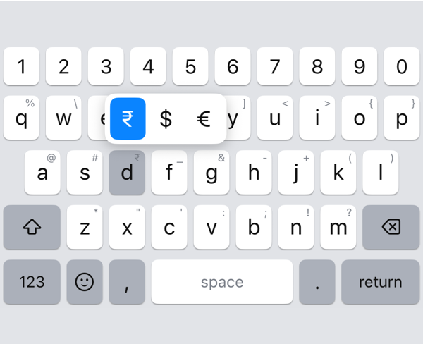
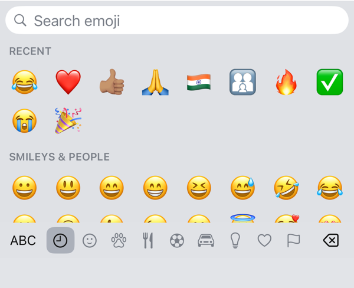
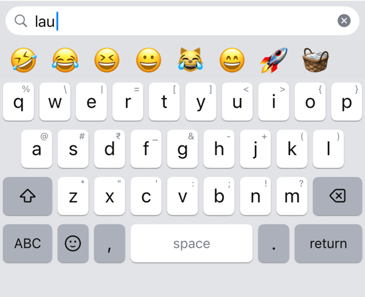

# kittykeys

An open-source iPhone keyboard for English and Hinglish, laid out like SwiftKey. It never autocorrects, so Hinglish
words stay exactly as you type them. Nothing you type leaves your phone.

<p>
  
  
  
</p>

kittykeys is early. It is tested on one iPhone, and it changes often.

## What works now

- A number row above the letters, and symbols on long-press, with each key's symbol shown in its corner
- Hold the space bar and slide to move the cursor
- An emoji panel with Recent, categories, skin tones and search
- Your currency first when you hold d, from your region or picked in Settings
- Themes, like SwiftKey's: ten ready-made ones, including black with neon green, or your own colours, key style
  (filled, outlined or no borders), shadow and font; a separate theme for dark mode if you like
- In web addresses a full-width space bar; hold . for .com, .in and other endings
- Your Text Replacement shortcuts from iOS Settings, such as "omw" for "On my way!"; ⌫ right after puts the shortcut
  back
- In a one-time code field it switches to the next keyboard, so Apple's keyboard (list it right after kittykeys) can
  offer the code from Messages; iOS gives SMS codes to no other keyboard

Coming later: next-word and emoji suggestions from the anantara prediction engine (not public yet), and glide typing.

## Install

kittykeys isn't on the App Store. Install it by sideloading with [SideStore](https://sidestore.io) (or AltStore).

1. In SideStore, add this source to get updates as they're released:

   ```
   https://github.com/vivekpayasi/kittykeys/releases/latest/download/source.json
   ```

   Or download `kittykeys.ipa` from the [latest release](https://github.com/vivekpayasi/kittykeys/releases/latest) and
   install it from SideStore's My Apps → +.
2. Open the kittykeys app and follow its Setup tab: turn on the keyboard and **Allow Full Access** in Settings.

Full Access is for haptics and for reading the settings you pick in the app. kittykeys has no network code.

It needs iOS 26 or later.

## Build from source

You need Xcode 27 and [XcodeGen](https://github.com/yonaskolb/XcodeGen).

```sh
cp Config/Local.xcconfig.example Config/Local.xcconfig   # then set your team and bundle prefix
xcodegen generate
open Kittykeys.xcodeproj
```

- `cd Packages/KittykeysCore && swift test` runs the tests. The keyboard's logic lives in this Swift package, free of
  UIKit.
- `scripts/build-ipa.sh` builds an ad-hoc signed IPA for SideStore, which signs it again with your Apple ID.
- `scripts/release.sh <version>` publishes a GitHub release and updates the SideStore source.

The design is in [`docs/design.md`](docs/design.md), and the build plans and their progress are in
[`docs/plans/`](docs/plans).

## License

Apache License 2.0; see [`LICENSE`](LICENSE). Third-party material and its licenses are listed in
[`THIRD_PARTY_NOTICES.md`](THIRD_PARTY_NOTICES.md).
